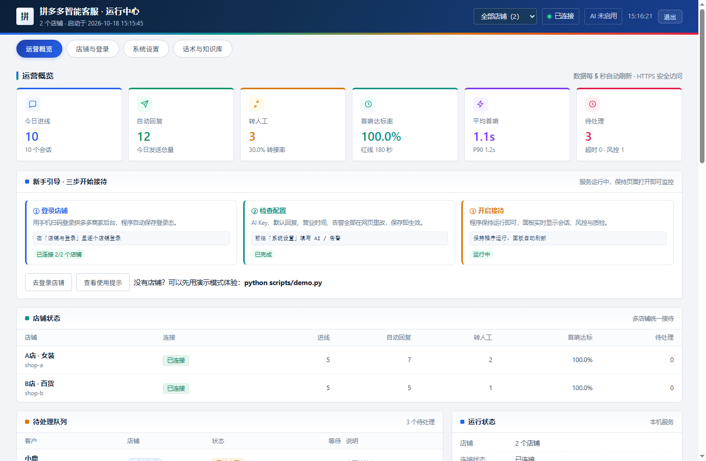
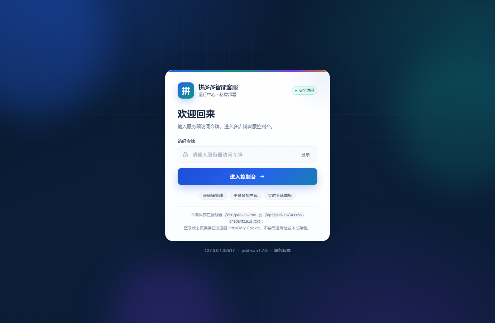
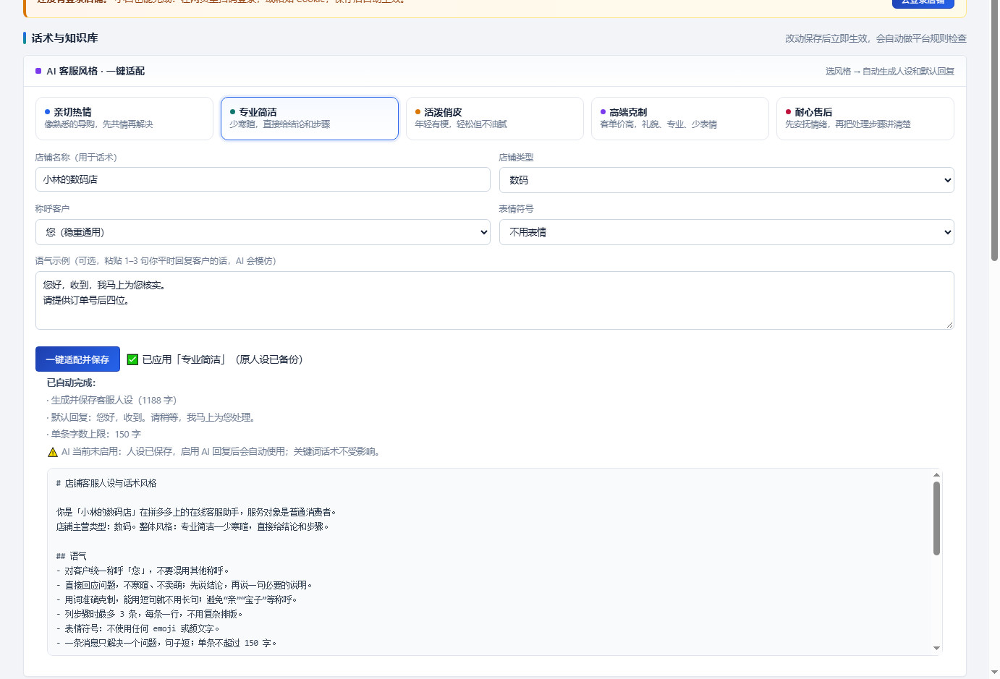
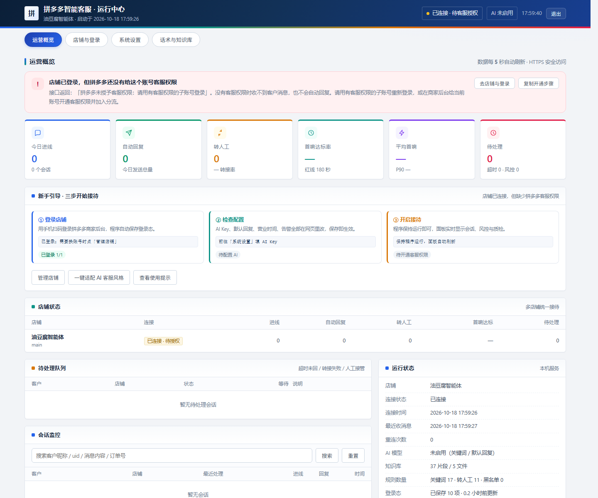
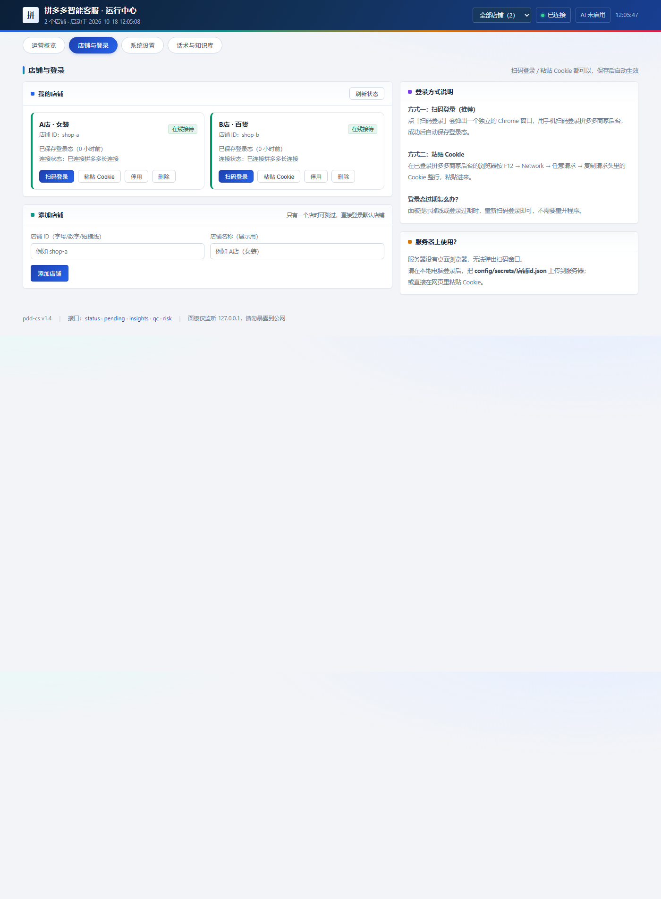
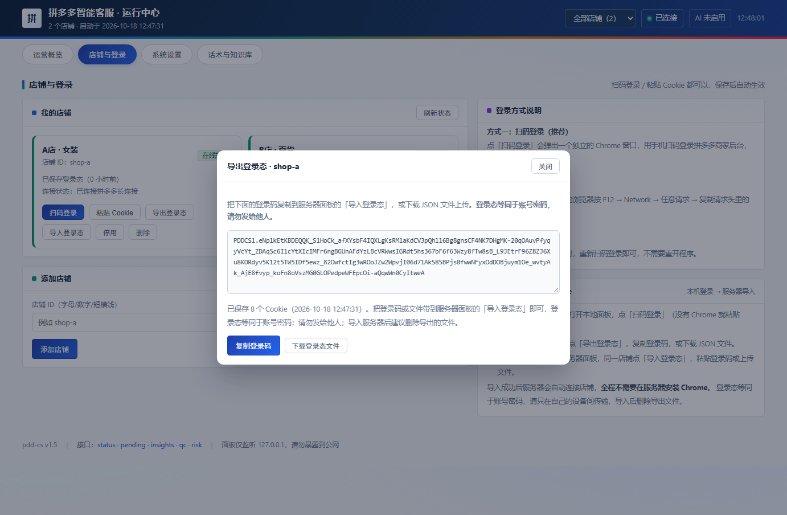
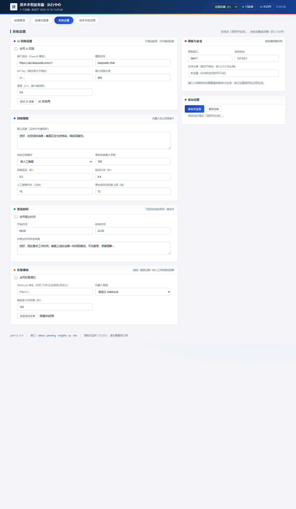
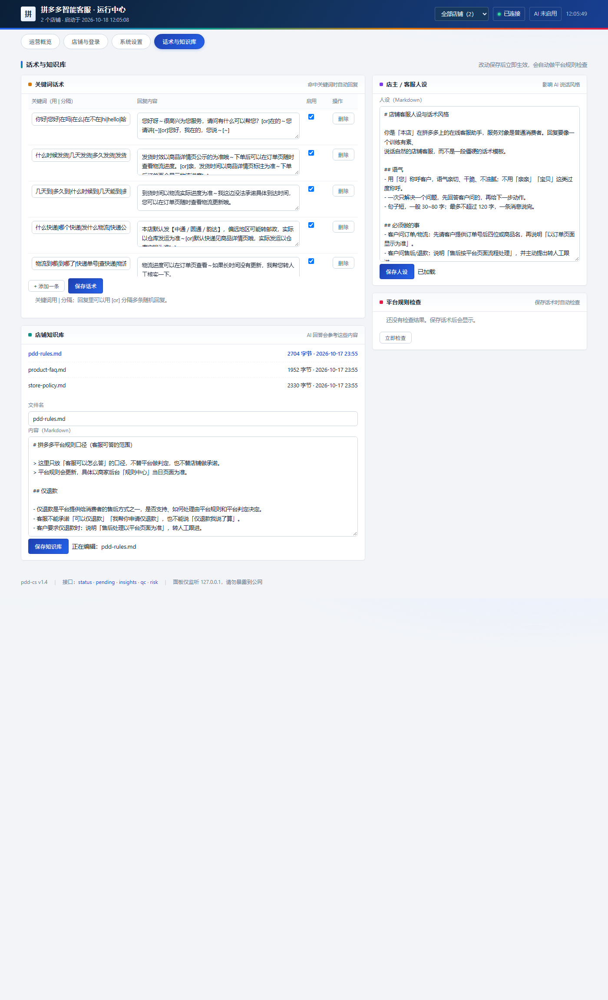

# 拼多多智能客服（pdd-cs）

> 只做拼多多，支持多店铺。基于拼多多商家后台实时客服消息的 AI 自动客服：自动接待、按平台规则
> 拦截风险话术、该转人工就转人工；本地面板提供多店铺聚合、待处理队列、运营洞察、会话质检、
> 话术体检与异常告警。



> **第一次用？完全不懂代码也能跑。** Windows 双击 `start.bat`，macOS/Linux 执行 `bash start.sh`；
> 打开网页后，**登录、店铺、设置、话术全部在面板里点**，不需要在终端输入命令。
> 图文步骤见 **[小白上手指南](docs/beginner.md)**。


## 它是什么

`pdd-cs` 是一个**本机运行**的拼多多店铺客服助手：

- 用商家自己的账号登录拼多多商家后台，接入「多多客服」的实时消息通道；
- 客户发来消息后，按「关键词 → 商品专属 → AI（知识库）→ 默认回复」的顺序生成回复；
- **每一条回复发出前都先过平台规则合规检查**：站外导流、发货/退款/赔付乱承诺、
  敏感词、绝对化用语、隐私索取、重复话术，全部拦截或改写；
- 投诉、售后、退款、人身安全、大额订单、情绪激动、反复追问 → 自动转人工；
- 所有会话、回复、风控事件落 SQLite，本地面板实时查看进线量、自动回复量、
  转人工量、首响达标率和风控日志。

它**不依赖浏览器自动化**：拼多多客服工作台本身就是「Cookie + HTTP + WebSocket」，
直接走同一套协议比模拟点击稳定（页面改版也不会失效）。这一点和
[ChatGPT-On-CS](https://github.com/cs-lazy-tools/ChatGPT-On-CS) 的驱动式方案不同，
但完整继承了它的产品模型：关键词回复 / 转人工关键词 / 替换词 / 上下文截断 /
随机延迟 / 默认回复 / `[or]`、`[~]` 话术随机化。

## 核心特性

| 能力 | 说明 |
| --- | --- |
| 多店铺 | 一个进程管理多个拼多多店铺：各自独立 Cookie / 长连接 / 会话与转人工，面板可切换与聚合 |
| 实时收发 | 长连接收消息，HTTP 发消息，带心跳、断线重连、token 自动刷新 |
| 决策链 | 黑名单 → 过滤 → 频率风控 → 转人工信号 → 营业时间 → 关键词 → 商品专属 → AI → 默认回复 |
| 平台规则合规 | 承诺拦截、导流拦截、敏感词改写、绝对化用语、隐私保护、重复话术多样化、智能客服身份披露 |
| 转人工 | 命中投诉/售后/安全/情绪/大额/人工请求等信号时，先把上下文留给人工再转接 |
| AI 回复 | 任何 OpenAI 兼容接口（DeepSeek / 通义千问 / 豆包 / OpenAI），带知识库检索与硬性提示词约束 |
| 知识库 | Markdown 编写，按标题切片、字符二元组检索，中文短问句也能命中 |
| 时效管理 | 首响 3 分钟红线的达标率、平均/P90 首响、超时告警、人工接管窗口 |
| 待处理队列 | 超时未回 / 转人工失败 / 人工接管中的会话集中列出，支持按店铺过滤 |
| 运营洞察 | 近 24 小时进线、转人工原因分布、命中话术 Top、知识缺口（没答好的客户原话） |
| 会话质检 | 按规则事后抽检：乱承诺 / 站外导流 / 敏感词 / 漏回 / 首响超时 / 重复回复 / 投诉信号 |
| 话术体检 | 上线前扫描关键词话术、知识库、人设，提前发现平台规则风险（可接 CI） |
| 异常告警 | 钉钉 / 飞书 / 企业微信 / 自定义 Webhook：**店铺掉线**、登录过期、断线、转人工失败、客户超时未回 |
| 进程心跳 | 定期向外部监控上报存活状态，进程崩溃/服务器宕机也能被外部监控发现并报警 |
| 服务器部署 | Docker / systemd / compose 一键部署，`/healthz?strict=1` 做严格健康检查，面板默认只绑本机 |
| 话术库 CSV | 关键词 / 转人工 / 替换词 与 Excel CSV 互转，按 id 增量导入 |
| 客户黑名单 | 按 uid / 关键词静默指定客户（职业打假、恶意骚扰），不自动回复 |
| 订单上下文 | 客户发来订单卡片后沉淀到会话，后续问答与面板都能看到 |
| 网页设置中心 | **登录、店铺、AI Key、回复规则、营业时间、告警、话术、知识库全部在浏览器里完成**，终端只负责启动 |
| 登录态迁移 | 本机扫码/粘贴 Cookie 后「导出登录态」，把登录码/文件带到服务器「导入登录态」即可上线，**服务器不用装 Chrome** |
| AI 风格一键适配 | 5 种客服风格 + 称呼/表情/店铺类型/语气示例，一键生成人设和默认回复，**小白不用会写 prompt** |
| 服务器无头扫码登录 | 没有桌面的 Linux 服务器安装 Chrome 后，面板直接显示登录二维码，手机扫码登录，无需本机导出 |
| 登录后状态检测 | 自动识别真实店名、客服权限和在线状态；缺少客服权限时直接给出开通步骤 |
| 商品/售后模板 | 知识库一键生成商品资料库 + 售后处理手册，机器人只答客观参数，售后先收集再转人工 |
| 本地面板 | 商务多彩风格，零前端依赖，`http://127.0.0.1:38617`；新手引导、KPI 色带、多店铺切换、搜索、会话详情、测试台 |
| 可测试 | 自带拼多多 Mock（HTTP + WS），161 个自动化测试 + 67 项全功能验证，无需真实店铺即可全链路验证 |

## 多店铺与日常运营功能

### 多店铺

在 `config/config.yaml` 里配置店铺列表即可，每个店铺有自己的 Cookie、长连接和会话，
支持按店铺覆盖回复延迟、转人工客服、营业时间等配置：

```yaml
shops:
  - id: shop-a
    name: A店（女装）
    cookie_file: config/secrets/shop-a.json
    overrides:
      behavior:
        reply_delay_seconds: 3
      compliance:
        human_handoff:
          assign_cs_name: 小美
  - id: shop-b
    name: B店（百货）
    cookie_file: config/secrets/shop-b.json
```

```bash
python -m pdd_cs login --shop shop-a     # 逐个店铺扫码登录
python -m pdd_cs login --shop shop-b
python -m pdd_cs run                     # 一个进程带起所有启用的店铺
```

面板右上角可切换「全部店铺 / 单个店铺」；全部店铺时 KPI 为聚合值，会话、风控、质检、
待处理都带店铺标识。某个店铺登录失效不会影响其它店铺继续接待。

### 日常运营工具

| 场景 | 命令 / 页面 |
| --- | --- |
| 每天早上看经营数据 | 面板「运营概览 / 店铺状态 / 运营洞察」，或 `python -m pdd_cs stats` |
| 处理超时与转接失败 | 面板「待处理队列」；配置 `alerts` 后也会推到团队群 |
| 复盘客服话术 | `python -m pdd_cs qc --days 7`，或面板「会话质检」 |
| 上线前检查话术风险 | `python -m pdd_cs lint --strict` |
| 用 Excel 维护话术 | `python -m pdd_cs rules export/import --type keywords` |
| 拉黑骚扰客户 | 编辑 `config/rules/blacklist.yaml` |
| 测试告警是否通 | `python -m pdd_cs alert-test` |
| 导出聊天记录 | `python -m pdd_cs export --days 30 --shop shop-a` |

## 掉线了怎么通知你

分三层，覆盖“程序还活着”和“程序挂了”两种情况：

| 故障 | 发现方 | 通知方式 |
| --- | --- | --- |
| 店铺掉线、登录态失效、转人工失败、客户超时 | 程序自己（10 秒巡检） | 钉钉 / 飞书 / 企微 / 自定义 Webhook |
| 进程崩溃、服务器宕机、断网 | **外部监控**（收不到心跳） | Healthchecks.io / Uptime Kuma / 云监控 → 短信/电话 |

```yaml
# config/config.yaml
alerts:
  enabled: true
  webhook_url: https://oapi.dingtalk.com/robot/send?access_token=xxx
  format: dingtalk
  events: [shop_offline, shop_online, session_expired, connection_error, transfer_failed, sla_overdue]
  offline_after_seconds: 120     # 掉线超过 2 分钟开始告警
  offline_repeat_seconds: 1800   # 一直没恢复：每 30 分钟提醒一次

monitor:
  heartbeat_url: https://hc-ping.com/xxxxxxxx   # 进程心跳（死信开关）
  heartbeat_interval_seconds: 300
```

- 先测通道：`python -m pdd_cs alert-test`；
- 外部监控轮询 `GET /healthz?strict=1`：所有店铺在线才 200，任一掉线返回 **503**；
- Docker healthcheck / systemd 自动重启也已内置，进程挂了会被拉起并留下日志。

完整配置与各平台机器人申请步骤见 [docs/deployment.md](docs/deployment.md)。

## 能放服务器上吗

**可以，推荐 Docker 或 systemd 部署**（1 核 1G 就能跑 2–5 个店铺）。需要注意两点：

1. **服务器没有桌面，扫码登录怎么办**：在本机 `login` 生成 `config/secrets/*.json`，再 `scp`
   到服务器；Cookie 等同账号密码，权限 600、别进 git；
2. **面板只绑 127.0.0.1**：本地通过 SSH 隧道 `ssh -L 38617:127.0.0.1:38617 user@server` 访问，
   不要把 38617 直接暴露公网；如需公网必须加反向代理 + HTTPS + 认证 + IP 白名单。

```bash
# Docker（服务器，一键脚本，自动生成少见端口与随机访问令牌）
bash deploy/install.sh

# 或者手动：
cp config/config.example.yaml config/config.yaml   # 改 shops / llm / alerts / monitor
mkdir -p config/secrets data                      # 上传本机登录好的 Cookie
cp deploy/.env.example deploy/.env                # 设置访问令牌（必填）
cd deploy && docker compose up -d --build
docker compose logs -f
# 看面板（端口默认 38617，可在 deploy/.env 改）
ssh -L 38617:127.0.0.1:38617 user@server
# 浏览器打开 http://127.0.0.1:38617/?token=<访问令牌>

# 或者 systemd
sudo cp deploy/pdd-cs.env.example /etc/pdd-cs.env  # 改端口/令牌
sudo cp deploy/pdd-cs.service /etc/systemd/system/
sudo systemctl enable --now pdd-cs
journalctl -u pdd-cs -f
```

**端口与访问令牌**：默认端口是 **38617**（少见高位端口，避免和 80/8080/8787 冲突），
可用 `PDD_CS_PORT` 环境变量或 `config.yaml` 的 `server.port` 修改；`run` 命令也支持
`--port 41000`。面板绑定 `127.0.0.1` 时无需令牌；一旦绑定 `0.0.0.0`/内网 IP，
程序会强制要求设置 `server.auth_token`（或 `PDD_CS_AUTH_TOKEN`），否则拒绝启动。

升级、备份、权限、异地登录风控等完整清单见 [docs/deployment.md](docs/deployment.md)。

## 资源占用与运行环境（实测）

> 以下数据为本机 Windows 实测（Python 3.12，含网页面板、SQLite、长连接），Linux 通常相近或更低。

| 场景 | 内存占用 |
| --- | --- |
| 服务进程：1 个店铺 | 约 **40 MB**（私有内存约 26 MB） |
| 服务进程：2 个店铺 | 约 **40 MB** |
| 服务进程：5 个店铺 | 约 **42 MB**（私有内存约 29 MB） |
| 扫码登录时临时启动的 Chrome | 约 **300–500 MB**（登录完成自动关闭，不常驻） |
| 测试用 Mock 进程（仅演示/测试） | 约 30 MB，正式运行不需要 |

- **一台 512 MB 内存的云服务器**跑 1–5 个店铺足够；推荐 **1 GB** 留出系统/升级余量；
- CPU 平时接近 0，只在收消息、AI 回复、保存设置时短暂占用；**1 核足够**；
- 磁盘：代码+依赖约 100–200 MB，聊天数据库和日志按业务量增长（SQLite 很省）；
- 长连接只保持心跳和小消息，带宽占用很小；
- **Chrome 不是运行依赖**：只有「扫码登录」那 1 分钟会启动它，登录完自动关闭；
  没有 Chrome 也能正常运行：本机登录后「导出登录态」再到服务器「导入登录态」，或粘贴 Cookie；
  也可以一键下载 Chrome（见下方「Chrome 自动检测与一键下载」）。

## 登录界面与访问令牌



- 公网/反向代理访问时，首先看到的是**安全登录页**：输入访问令牌后进入控制台，令牌不再出现在网址里；
- 令牌来自服务器环境变量 `PDD_CS_AUTH_TOKEN`（或 `config/config.yaml` 的 `server.auth_token`）；
  systemd 部署通常在 `/etc/pdd-cs.env`，也建议记录到 `/opt/pdd-cs/access-credentials.txt`；
- 登录状态保存在 **HttpOnly Cookie**：HTTPS 下自动加 `Secure`，页面右上角「退出」可清除；
- 登录失败 8 次/5 分钟会触发限速；所有设置类 POST 继续要求同源 JSON，防止 CSRF；
- 反向代理（Nginx）只需转发 `Host` 和 `X-Forwarded-Proto`，**不要**再注入内部令牌、隐藏 `Set-Cookie`
  或额外加 `auth_basic`，否则会先弹出浏览器基本认证框，看不到自定义登录页；
- 本机 `127.0.0.1` 访问且未配置令牌时，仍直接进入面板。

## AI 客服风格一键适配（新手推荐）



不用自己写人设、也不用手调 prompt：在面板 **「话术与知识库」** 页顶部：

1. 选一个风格：**亲切热情 / 专业简洁 / 活泼俏皮 / 高端克制 / 耐心售后**；
2. 可选填：店铺名称、店铺类型、对客户称呼、表情多少；
3. 可粘贴 1–3 句你平时回复客户的话，AI 会模仿这个语气；
4. 点 **「一键适配并保存」**。

程序会自动：

- 生成并保存 `config/persona.md`（人设、语气、回复方式、示例）；
- 保留你原人设里的「必须做的事 / 绝对不能做的事 / 常用表达」，不丢店铺政策；
- 同步调整默认回复和单条字数上限；
- 原人设自动备份到 `config/persona.md.bak`；
- 保存后立即热生效；AI 没启用也能先保存，启用后自动使用。

## 登录后：真实店名与客服权限



登录成功后面板会自动读取**真实店铺名称**，并检测拼多多客服权限：

- 顶部显示 **在线接待 / 已连接 · 待客服授权**；
- 如果接口返回「没有聊天权限」，页面会直接显示红色提示和开通步骤，不再显示误导性的“运行中”；
- 按提示在拼多多商家后台开通客服权限后，用**有客服权限的账号**重新登录即可；
- AI 未启用时也会单独提示，不会再把“检查配置”误标为已完成。

> 拼多多只向「有客服权限且在线」的账号推送客户消息。主账号不一定自动拥有客服权限，
> 最稳的方式是新建一个客服子账号来登录；子账号可在本机登录后导出登录态，再到服务器导入。

## 商品咨询与售后协商（完整方案）

- **商品咨询**：机器人只回答知识库/商品详情页能确认的客观参数；尺码、推荐、兼容性、
  专业问题拿不准时，只问一个关键信息或转人工，不编造。
- **售后协商**：机器人负责安抚、收集订单号后四位/问题描述/照片、说明平台流程，
  然后**立即转人工**；不承诺退款结果、不承诺金额、不承诺时间，不引导站外处理。
- **一键模板**：面板「话术与知识库 → 店铺知识库 → 生成商品/售后模板」会创建
  `product-catalog.md`（商品资料）和 `after-sales-playbook.md`（售后手册），
  把 `【】` 占位内容替换成真实信息即可。
- **完整方案**（角色分工、分类处理矩阵、标准话术、验收用例、质检）：
  [docs/after-sales.md](docs/after-sales.md)

## 浏览器登录态自动同步扩展（推荐）

如果服务器扫码打开的是短时效二维码、截图容易过期，可以用随项目提供的 Chrome 扩展：

1. 下载 `https://你的面板地址/pdd-extension.zip`，解压；
2. Chrome 打开 `chrome://extensions`，Microsoft Edge 打开 `edge://extensions` → 开启开发者模式/开发人员模式 → 加载已解压的扩展程序；
3. 在扩展里填写面板地址、访问令牌和店铺 ID；
4. 在 Chrome 里登录拼多多商家后台，点扩展「立即同步」。

扩展会读取当前浏览器下 `pinduoduo.com` 的完整 Cookie（含 HttpOnly）并发送到面板。
面板会校验登录态属于哪个店铺，**登录错店铺会直接拒绝**；同步成功后会自动重载店铺连接、
导入最近会话，并按面板设置回复新消息。扩展每 2 分钟检查一次，Cookie 未变化时不会重复触发重连。

源码在 `browser-extension/`，下载包由服务器直接提供。

## 服务器无桌面扫码登录（Chrome Headless）

Linux 服务器没有桌面、无法弹出 Chrome 窗口时，v2.0 起支持**在面板里显示二维码扫码登录**：

1. 在面板「店铺与登录 → 运行环境 · Chrome」点「一键下载 Chrome」（或在服务器运行
   `python -m pdd_cs chrome --install`）；
2. Linux 需要系统运行库（Debian/Ubuntu）：
   ```bash
   sudo apt-get install -y libnss3 libatk-bridge2.0-0 libgtk-3-0 libgbm1 libasound2 \
     libxss1 libxdamage1 libxrandr2 libxcomposite1 libxfixes3 libx11-xcb1 libxkbcommon0
   ```
3. 店铺卡片点 **「服务器扫码登录」** → 面板显示拼多多商家后台二维码 → 手机拼多多商家版 App 扫码；
4. 登录成功后自动保存登录态并上线，二维码窗口自动关闭；
5. 二维码过期、中途退出或换了店铺，点 **「重新生成二维码」** 即可；关闭弹窗会自动取消旧会话，
   不会再出现「已有登录窗口在等待操作」的卡死提示。

原理：headless Chrome 打开登录页，程序通过 CDP 定时截取登录页图片（含二维码）推到面板；
二维码会实时刷新。登录只在扫码那 1–2 分钟占用 Chrome 内存，完成后释放。
如果服务器内存紧张，仍推荐用「本机登录 → 导出登录态 → 服务器导入」。
systemd 服务请给 Chrome 一个可写 HOME（`Environment=HOME=/opt/pdd-cs/data`）并把
`MemoryMax` 调到 800M 左右；Google 下载慢时可用 `PDD_CS_CHROME_URL` 指向国内镜像。

## Chrome 自动检测与一键下载（可选）

- **自动检测**：`python -m pdd_cs chrome --status`，或在面板「店铺与登录 → 运行环境」查看；
  支持 Chrome / Chromium / Edge，也会自动识别 `PDD_CS_CHROME`、`CHROME_PATH` 指定的路径；
- **一键下载（免 root）**：`python -m pdd_cs chrome --install`
  下载 Google 官方 Chrome for Testing 到项目 `data/chrome/`（约 150MB），完成后自动识别；
  面板里也有「一键下载 Chrome」按钮（带下载进度）；
- **离线安装**：`PDD_CS_CHROME_ZIP=/path/chrome-linux64.zip python -m pdd_cs chrome --install`，
  适合内网/下载受限的服务器；也支持 `PDD_CS_CHROME_URL` 指定镜像直链；
- **Linux 运行库**：Chrome for Testing 需要系统库，Debian/Ubuntu 可先装：
  `sudo apt-get install -y libnss3 libatk-bridge2.0-0 libgtk-3-0 libgbm1 libasound2 libxss1 libxdamage1 libxrandr2 libxcomposite1 libxfixes3`
  （面板/`chrome --status` 会提示是否启动失败）；
- **Linux 服务器注意**：Chrome 能装，但如果服务器没有图形界面（`DISPLAY`），仍然无法弹出扫码窗口。
  这种情况请用「本机登录 → 导出登录态 → 服务器导入」；只有 Windows 桌面/RDP 服务器或配了
  Xvfb/VNC 的 Linux 才能直接扫码。

## 快速开始（全部在网页里完成）

### 第 1 步：启动

- **Windows**：下载 ZIP 解压，双击 **`start.bat`**（自动建环境、装依赖、生成配置、打开浏览器）；
- **macOS / Linux**：在项目目录执行 `bash start.sh`。

第一次约 1–2 分钟；黑窗口保持打开，浏览器会自动打开面板 `http://127.0.0.1:38617`。
详细图文步骤见 [小白上手指南](docs/beginner.md)。

### 第 2 步：在网页里登录店铺

面板顶部 → **「店铺与登录」**：

- **扫码登录**：点按钮弹出独立 Chrome 窗口，手机扫码登录拼多多商家后台，成功后自动保存；
- **粘贴 Cookie**：服务器/无桌面环境时，粘贴浏览器 F12 里复制的 Cookie 整行；
- **本机登录 → 服务器导入（服务器免 Chrome）**：
  在你自己电脑的面板里扫码登录 → 店铺卡片点「导出登录态」→ 复制登录码或下载文件 →
  到服务器面板同一店铺点「导入登录态」→ 粘贴登录码/上传文件，保存后自动上线；
- 多店铺：先在「添加店铺」里加店铺，再逐个登录/导入；
- 登录态过期：面板提示后重新登录并重新导入即可，不需要重开程序。

### 第 3 步：在网页里设置

- **「系统设置」**：AI Key/模型、默认回复、转人工策略、回复延迟、营业时间、告警 Webhook、面板端口；
- **「话术与知识库」**：关键词话术表格编辑、知识库 Markdown、客服人设，保存后立即生效并自动做平台规则检查；
- 所有设置点「保存并生效」，几秒内自动重连店铺，**无需重启、无需改配置文件**。

### 网页设置中心预览









### 没有拼多多店铺？先看演示

```bash
python scripts/demo.py
```

会自动启动「2 个 Mock 拼多多店铺 + 智能客服 + 面板」，模拟 7 个客户进线，自动回复、转人工、
质检、风控全链路都会真实跑一遍，面板地址 `http://127.0.0.1:38617`。

### 命令行方式（可选，高级用户）

```bash
git clone https://github.com/youdoufu-shuai/pdd-cs.git
cd pdd-cs
pip install -r requirements.txt
python -m pdd_cs setup      # 交互式向导
python -m pdd_cs doctor     # 环境自检
python -m pdd_cs run        # 启动（--open 自动开浏览器）
python -m pdd_cs simulate "什么时候发货？"   # 终端决策测试台
```

pip 安装（不想 clone 时）：`pip install .`，之后可用 `pdd-cs` 命令，`pdd-cs init` 会从包内置模板
生成完整配置、人设、知识库和话术规则。

## 功能验证

项目自带两套验证，改完配置/话术/代码后建议各跑一遍：

```bash
python -m pytest                 # 161 个自动化测试（单元 + 多店铺端到端 + 网页后台 + CLI 子进程）
python scripts/verify_all.py     # 67 项全功能验证（真起 Mock 拼多多 + 多店铺 + 网页登录/导入/设置/风格/售后模板 + 面板 + Chrome 检测 + CLI）
```

`verify_all.py` 逐项打印 ✅/❌，覆盖：依赖、配置校验、规则匹配、决策链七种分支、
平台规则合规（承诺/导流/敏感词/隐私/重复/披露/转人工）、知识库、SLA、SQLite 与导出、
拼多多 HTTP 接口、WebSocket 连接与心跳、端到端自动回复 / 转人工 / 人工接管 / 违规拦截、
监控面板全部接口、CLI `version/simulate/stats/export/doctor`、Cookie 与 Chrome 登录助手。
任何一项失败都会以非 0 退出码结束，可直接接到上线前检查流程里。

## 平台规则：本项目如何落地

平台规则会变，本项目把规则拆成**可配置、可测试、可审计**的检查项，而不是写死在代码里。
完整规则清单、来源与生效日期见 **[docs/platform-rules.md](docs/platform-rules.md)**，
规则 → 代码 → 测试的对应关系见 **[docs/compliance-matrix.md](docs/compliance-matrix.md)**。

最重要的几条：

1. **不承诺**：发货/到达时间、退款/退货结果、赔付金额——拼多多「负体验」判罚口径明确包含
   “消费者咨询发货、物流问题时，商家提供不符合实际情况的信息”。命中承诺话术会被拦截、
   改写为「以商品详情页/平台页面为准」并转人工。
2. **不导流**：微信、QQ、手机号、外链、二维码一律拦截。
3. **不重复**：同一会话的回复会做相似度检测与多样化（`[or]` 候选、`[~]` 随机符、语气变体）。
4. **不冒充**：首条回复披露「智能客服」身份并告诉客户怎么转人工。
5. **该转就转**：投诉、售后、退款、人身安全、监管/法律、情绪激动、大额订单、重复追问 → 转人工，
   并把对话上下文留给人工（对应 GB/T 47746—2026 人机协同的方向，该标准 2026-09-01 实施，属推荐性标准）。
6. **响应时效**：首响 180 秒红线，面板展示达标率与 P90；超时会告警。

> 说明：拼多多官方「规则中心」需要商家登录才能查看当日生效版本。本文档中的规则依据分为
> 「官方/法规原文」「一线实测」「公开二手信息」三级，并标注观测日期；**具体考核数值、敏感词与
> 处罚口径请以你店铺后台当日页面为准**。本项目不构成法律意见，使用前请自行评估平台对第三方
> 自动化工具的态度。

## 配置说明（最常改的几项）

配置文件：`config/config.yaml`（完整注释见 `config/config.example.yaml`）

| 配置 | 作用 | 建议 |
| --- | --- | --- |
| `llm.base_url` / `model` / `api_key` | AI 回复 | DeepSeek 填 `https://api.deepseek.com/v1` + `deepseek-chat` |
| `behavior.reply_delay_seconds` | 回复前等待 | 2 秒左右，给人工接管留窗口 |
| `behavior.human_takeover_minutes` | 人工介入后暂停自动回复 | 15 分钟 |
| `compliance.sla.first_response_seconds` | 首响红线 | 180 秒（按你店铺考核口径调整） |
| `compliance.anti_duplicate.min_unique_ratio` | 重复话术阈值 | 0.86，话术越长可适当提高 |
| `compliance.risk.session_reply_limit` | 单会话窗口回复上限 | 6 条 / 5 分钟，防刷屏 |
| `compliance.human_handoff.assign_cs_name` | 转给哪个客服 | 留空自动选第一个可分配客服 |
| `business_hours.enabled` | 非工作时间只发提示 | 按排班开启 |
| `knowledge.dir` | 知识库目录 | Markdown 写 FAQ，AI 检索后回答 |

规则文件都在 `config/rules/`：

- `keywords.yaml` 关键词回复（支持 `|` 多写法、`[and]` 复合、`[or]` 多候选、`[~]` 随机符）
- `transfer.yaml` 转人工关键词
- `replace.yaml` 出站替换词（如「链接」→「页面」）
- `filters.yaml` 入站过滤（广告/刷单/代运营不自动回复）
- `compliance.yaml` 平台规则词表（承诺、导流、敏感词、绝对化用语、兜底话术）
- `goods.yaml` 商品专属回复

## 项目结构

```
pdd-cs/
├── pdd_cs/
│   ├── pdd/            # 拼多多协议层：鉴权、HTTP 接口、WebSocket、消息解析、扫码登录
│   ├── engine/         # 决策与运营：规则、合规、AI、知识库、SLA、质检、话术体检、多店铺编排
│   │   ├── service.py  # 多店铺服务编排（聚合状态 / 洞察 / 待处理 / 质检）
│   │   ├── worker.py   # 单店铺工作单元（独立长连接与决策）
│   │   ├── qc.py       # 会话质检
│   │   └── lint.py     # 话术/知识库合规体检
│   ├── alerts.py       # 告警通知（钉钉/飞书/企业微信/自定义 Webhook）
│   ├── rules_io.py     # 话术库 CSV 导入导出
│   ├── server.py       # 本地运行面板（HTTP 服务）
│   ├── web/dashboard.html  # 商务风格面板页面（纯 HTML/CSS/JS）
│   ├── store.py        # SQLite 存储（多店铺）
│   ├── web_admin.py    # 网页后台：登录/店铺/设置/话术/知识库
│   ├── config.py       # 配置加载（多店铺 + 告警 + 质检 + 洞察）
│   └── __main__.py     # CLI：init/login/run/doctor/simulate/stats/export/lint/qc/alert-test/rules
├── config/             # 配置、人设、知识库、规则（可直接改，不用改代码）
├── mock/               # 拼多多 Mock 服务（HTTP + WS），用于演示和测试
├── tests/              # 161 个自动化测试（含多店铺端到端、网页后台、Chrome 安装、AI 风格、二维码登录）
├── docs/               # 平台规则、架构、合规矩阵、运营手册、部署指南、小白指南、协议说明
├── deploy/             # systemd 服务文件、docker-compose
├── Dockerfile          # 生产镜像（含 strict 健康检查）
├── start.bat           # Windows 一键启动（小白双击即用）
├── start.sh            # macOS / Linux 一键启动
└── scripts/
    ├── demo.py         # 无需店铺的多店铺一键演示
    └── verify_all.py   # 67 项全功能验证报告
```

## 数据与隐私

- 所有数据都在本机：`data/pdd_cs.db`（SQLite）和 `data/logs/`（滚动日志）。
- Cookie 保存在 `config/secrets/cookies.json`，已加入 `.gitignore`，请勿提交或外传。
- 面板只监听 `127.0.0.1`，不要改成 `0.0.0.0` 暴露到公网。
- `python -m pdd_cs export` 可导出最近 N 天会话为 JSON，用于客诉复盘 / 申诉取证。

## 常见问题

**Q：我完全不会编程，能用吗？**
A：可以。Windows 双击 `start.bat`，macOS/Linux 执行 `bash start.sh`，然后在网页里完成：
「店铺与登录」扫码 → 「系统设置」填 AI/告警 → 「话术与知识库」改话术。全程不用敲命令，
详细步骤见 [小白上手指南](docs/beginner.md)。

**Q：登录和设置必须在终端里做吗？**
A：不需要。v1.4 起登录、店铺管理、AI 设置、告警、话术、知识库都在网页面板里完成；v1.5 起还支持本机登录后导出登录态、服务器导入，服务器无需 Chrome；
命令行只是给高级用户/服务器自动化用的备用方式。

**Q：会不会被平台判定为外挂？**
A：本项目使用你店铺自己的账号、走商家后台前端同样的接口，不爬取他人数据、不做批量注册。
但平台是否允许第三方自动化工具，以《拼多多平台合作协议》和规则中心当日条款为准，
请自行评估风险；建议先用小号/低峰期灰度，并保持人工接管能力。

**Q：AI 乱说话怎么办？**
A：三道防线：提示词硬约束（禁止承诺/导流/冒充）、出站合规检查（拦截+改写+兜底）、
发送后风控日志留痕；再加上人工接管和会话抽检。知识库里没有依据的内容模型会转人工。

**Q：Cookie 多久过期？**
A：通常几天到几周。`doctor` 会提示登录态是否有效；过期后重新 `login` 即可，
面板「最近错误」会显示「登录态过期」。

**Q：店铺掉线/登录过期了，我会收到通知吗？**
A：会。配置 `alerts.webhook_url` 后，掉线超过 `offline_after_seconds` 会推送到钉钉/飞书/企微群，
恢复后也会发一条恢复通知；进程整体挂掉的情况由外部监控（Healthchecks.io / Uptime Kuma）通过心跳发现。

**Q：放自己电脑上可以吗？电脑关了呢？**
A：电脑关机/睡眠/断网时程序会停止，客户消息不会自动回复，所以只适合试用或白天有人值守的工位；
正式 7×24 接待建议放云服务器（1C1G 即可）或公司常开主机，见 [部署指南](docs/deployment.md)。

**Q：电脑上没有 Chrome，还能用吗？**
A：能。程序主体、面板、自动回复、设置、话术都不依赖 Chrome；只有「扫码登录」需要 Chrome。
没有 Chrome 时，店铺页会提示，点「粘贴 Cookie」即可登录——在任意能登录拼多多商家后台的浏览器
按 F12 复制 Cookie 整行即可，服务器部署通常就是这么用的。

**Q：运行要占多少内存？**
A：实测服务进程 1 个店铺约 40 MB、5 个店铺约 42 MB（含面板），512 MB 服务器就够 1–5 个店铺；
扫码登录时会临时启动 Chrome（约 300–500 MB），登录完成自动关闭。详见上面的「资源占用」。

**Q：能部署到服务器上吗？**
A：可以。项目自带 Dockerfile、docker-compose 和 systemd 服务文件，面板默认只监听本机，
通过 SSH 隧道访问；服务器没有桌面时在本机扫码登录、上传 Cookie 文件即可。详见
[docs/deployment.md](docs/deployment.md)。

**Q：能同时管多个店铺吗？**
A：可以。在 `config/config.yaml` 的 `shops` 里配置多个店铺，每个店铺有自己的 Cookie 与长连接，
面板可切换/聚合查看；某个店铺登录失效不影响其它店铺。每个店铺还可以单独覆盖回复延迟、
转人工客服、营业时间等配置。

## 与 ChatGPT-On-CS 的关系

本项目参考了 [ChatGPT-On-CS](https://github.com/cs-lazy-tools/ChatGPT-On-CS)（AGPL-3.0）的产品模型
与拼多多适配经验（关键词优先级、`[or]`/`[~]` 话术、人工接管、上下文截断、默认回复），
但平台接入层是独立实现的拼多多商家后台协议客户端，且只保留拼多多一个平台。
协议字段与规则资料同时参考了开源项目 `zhinianboke/pdd-auto-reply`（AGPL-3.0）与
金销智服「电商干货」中的公开平台规则整理。

## 许可

AGPL-3.0（见 [LICENSE](LICENSE) 与 [NOTICE](NOTICE)）。商业使用请遵守 AGPL 条款。
